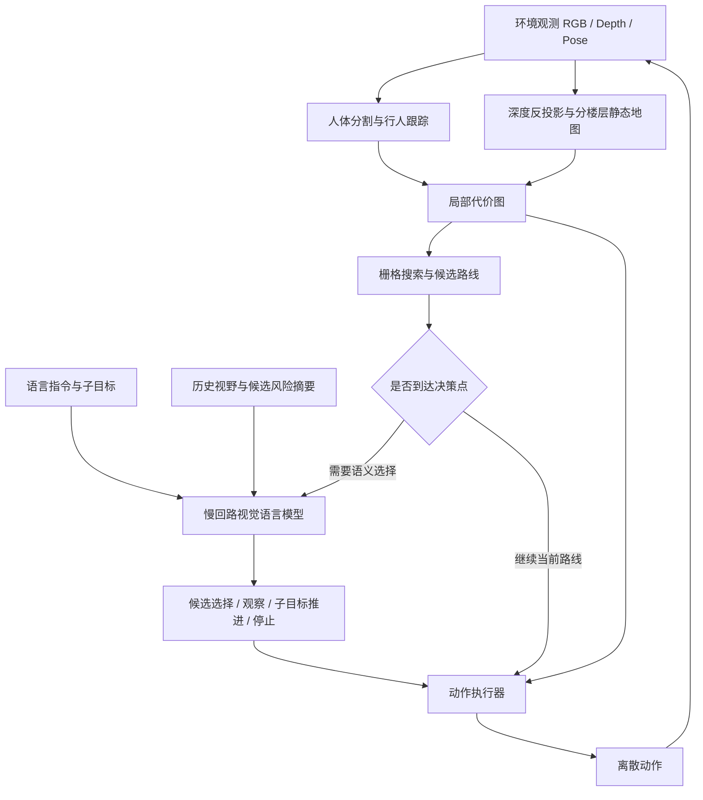

# 系统架构

## 背景与目的

HA-VLN 要求智能体按自然语言指令在有人活动的场景中导航。视觉语言模型负责指令和场景语义，几何规划负责路线是否可走，执行器把路线转成离散动作。两种决策速度通过门控连接。

## 每步导航闭环

入口为 `havln_agent/agent.py` 的 `HierarchicalAgent.act`。每次动作后重新获得观测，再更新地图和计划，形成在线反馈闭环。

## 模块对应

| 层 | 实现 | 职责 |
|---|---|---|
| 环境适配 | `adapters/habitat_env.py` | 环境观测与动作接口；评估所需特权信息单独封装 |
| 人体感知 | `perception/human_seg.py`、`mapping/human_layer.py` | 人体实例分割、跟踪、短期记忆 |
| 几何建图 | `mapping/virtual_laser.py`、`mapping/static_layer.py` | 深度反投影、楼层地图、障碍与高度判断 |
| 局部规划 | `mapping/costmap.py`、`planning/grid_search.py`、`planning/candidates.py` | 墙体及行人代价、栅格搜索、候选路线与风险 |
| 调用门控 | `planning/decision.py` | 路段完成、路口、失效或停滞等事件触发语义决策 |
| 语义决策 | `slow/prompts.py`、`slow/slow_loop.py`、`slow/llm_client.py` | 指令拆解、结构化输出、校验、重试与模型接口 |
| 视野记忆 | `slow/view_memory.py` | 为候选方向提供以前观察过的画面 |
| 动作执行 | `executor.py` | 路径跟踪、离散动作、安全检查与停止处理 |
| 评估诊断 | `rollout.py`、`metrics.py`、`oracle.py` | 轨迹、指标、失败归因及专家诊断 |

专家的参考路径、终点和导航网格用于采集标签或评估，不能作为正式模型推理的输入。相关入口见 [闭环流程](CLOSED_LOOP.md)。

## 已核对的任务设定

这些数来自公开源码或已记录的镜像检查，改参数前先对一下：

- 行人：120 帧 @ 10 Hz，按墙钟推进，12 秒后静止（`HASimulator/environments.py`）
- 碰撞：行人以静态物体加入场景并重算导航网格（agent 半径 0.1）。碰撞计数是 `sim.previous_step_collided`。按公开代码，擦墙也算。官方计分镜像 `/opt/havln-challenge/scoring` 是否只计人，仍需核对
- TCR = max(0, 碰撞数 − 参考路径上避不开的碰撞数)。CR 的分母是受人影响的 episode 比例（`HASimulator/metric.py`）
- 成功距离 3 m（三维欧氏距离，楼层错了高度差也算进去），必须主动 STOP。`ALLOW_SLIDING: True`。深度 256×256，RGB 224×224，HFOV 90
- 官方工具包的下载清单里没有训练集。`download_train.py` 按同一 Hugging Face 版本号拉取

## 楼梯与多楼层

高程图可通行性，加上 Habitat 多楼层导航（MFNP、ASCENT）里的分楼层建图：

- 每格存观测到的最低表面（只用低于相机的点）和身体高度内的最高点。格内竖直跨度超过一个台阶（0.2 m）是障碍。相邻已知格高差超过“台阶 + tan(38°) × 中间未观测缝宽”也是障碍，标在较高的一侧。楼梯逐级 0.18 m 能走；桌子、矮柜、平台边缘不能走。判定每次按当前高程重算
- 水平相机看不到脚前和比脚下低的地方。路线前方 1 m 内有未观测格时低头看一眼（两步），用来看下楼梯和断崖
- 脚下高度偏离本层参考高度超过 1.5 m，并且连续 3 步，就换一层图。新楼层先原地转一圈
- 候选标 `goes`: up / down / level，对应“上楼”“下楼”
- 行人按高度归属楼层
- 不另接楼梯检测模型。需要在镜像里核实导航网格最大台阶、坡度和 `TILT_ANGLE`（`scripts/check_env.py` 会打印）

## 停止确认

模型给出停止之后：

1. 有目标框就量框内深度，否则量模型指定的那一侧。≤ 2.5 m 则 `STOP_CONFIRMED`。
2. 太远就朝它走，最多 16 步。走完或被挡住后再量一次。
3. 仍然确认不了：不停，记一次 `STOP_REJECTED`，把原因写进下一次提示，回到决策。
4. 连续被驳回超过 `decision.max_stop_rejects`（默认 2）次后模型仍坚持，才按它的判断停（`STOP_UNCONFIRMED`）。日志里单独统计。
5. 模型没给方位（`goal_side=none` 且无框）时直接停，记 `STOP_NO_EVIDENCE`。

`stop` / `subgoal_done` 按严格布尔解析，字符串 `"false"` 不是真。认不出的值整条决策作废，走兜底。视野记忆按楼层分开存取。转身观察每条 episode 最多 `decision.max_observes` 次。
