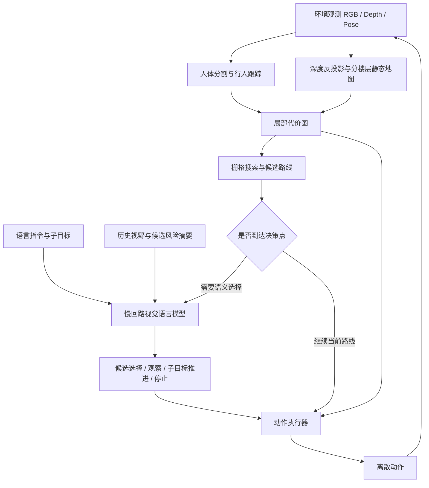

# 系统架构

## 背景与目的

HA-VLN 要求智能体按自然语言指令在有人活动的场景中导航。视觉语言模型负责指令和场景语义，几何规划负责路线是否可走，执行器把路线转成离散动作。两种决策速度通过门控连接。

## 每步导航闭环

入口为 `havln_agent/agent.py` 的 `HierarchicalAgent.act`。每次动作后重新获得观测，再更新地图和计划，形成在线反馈闭环。

## 模块对应

| 层 | 实现 | 职责 |
|---|---|---|
| 环境适配 | `adapters/habitat_env.py` | 环境观测与动作接口；评估所需特权信息单独封装 |
| 人体感知 | `perception/human_seg.py`、`mapping/human_layer.py` | 人体实例分割、跟踪、短期记忆 |
| 几何建图 | `mapping/virtual_laser.py`、`mapping/static_layer.py` | 深度反投影、楼层地图、障碍与高度判断 |
| 局部规划 | `mapping/costmap.py`、`planning/grid_search.py`、`planning/candidates.py` | 墙体及行人代价、栅格搜索、候选路线与风险 |
| 调用门控 | `planning/decision.py` | 路段完成、路口、失效或停滞等事件触发语义决策 |
| 语义决策 | `slow/prompts.py`、`slow/slow_loop.py`、`slow/llm_client.py` | 指令拆解、结构化输出、校验、重试与模型接口 |
| 视野记忆 | `slow/view_memory.py` | 为候选方向提供以前观察过的画面 |
| 动作执行 | `executor.py` | 路径跟踪、离散动作、安全检查与停止处理 |
| 评估诊断 | `rollout.py`、`metrics.py`、`oracle.py` | 轨迹、指标、失败归因及专家诊断 |

专家的参考路径、终点和导航网格用于采集标签或评估，不能作为正式模型推理的输入。相关入口见 [闭环流程](CLOSED_LOOP.md)。
