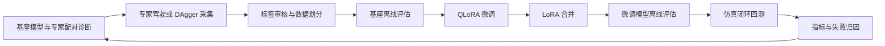

# 训练与评估闭环

## 目的

在线导航闭环是“观测 → 决策 → 动作 → 新观测”；训练闭环是“发现失败 → 采集决策标签 → 审核 → 微调 → 回测”。代码实现了这些阶段，阶段完成与导航性能达标需要分别核验。



## 入口与职责

| 阶段 | 入口 | 需要核对的证据 |
|---|---|---|
| 冒烟与配对诊断 | `scripts/stage.py smoke / paired` | 完成状态、基座与专家指标、候选覆盖和失败分布 |
| 决策数据采集 | `scripts/stage.py collect`、`scripts/gen_decision_data.py` | episode 完成情况、有效标签、候选及专家选择 |
| 审核与划分 | `scripts/training_watch.py` | 原始样本保留、重复和异常检查、划分审核 |
| 离线评估 | `scripts/stage.py offline`、`scripts/eval_decision_offline.py` | 候选选择、STOP、观察决策等指标 |
| 微调与合并 | `scripts/stage.py train`、`scripts/make_train_configs.py` | 实际训练步数、有限 loss、非零梯度、适配器与合并权重 |
| 仿真回测 | `scripts/stage.py closed` | 全部指定路线的最终指标与逐 episode 轨迹 |

`training_watch.py` 是现有 r0 流程的监督脚本，包含固定的审核规则和运行目录；它不是任意项目的通用调度器。`run_closed_single.py` 是既有 r0 等待状态下的单 GPU 恢复入口，要求旧监督进程已停止，并校验状态，不能替代普通 `stage.py closed` 命令。

## 现有运行环境中的阶段命令

```bash
GPU=none source scripts/native_env.sh
$HPY scripts/stage.py paired --n 20
$HPY scripts/stage.py collect --n 500 --tag r0
# 审核采集数据，并生成训练 / 验证划分后继续。
$HPY scripts/stage.py offline --run r0 --model base --data r0
$HPY scripts/stage.py train --run r0
$HPY scripts/stage.py offline --run r0 --model nav --data r0
$HPY scripts/stage.py closed --run r0 --model nav --n 20
```

GPU 选择、进程隔离、报告和状态写入由 `stage.py` 实现。数据路径与既有环境依赖见 [训练说明](TRAINING.md)。本仓库不包含环境安装产物、数据集或运行结果。

## 验证边界

训练完成、权重导出成功、离线准确率提高，都不能代替真实仿真中的导航成功率。已完成的 r0 原始闭环评估为 20 条路线、SR=0；后续控制和地形修复应重新运行完整评估，不能把旧权重描述成已验证的高成功率导航模型。
